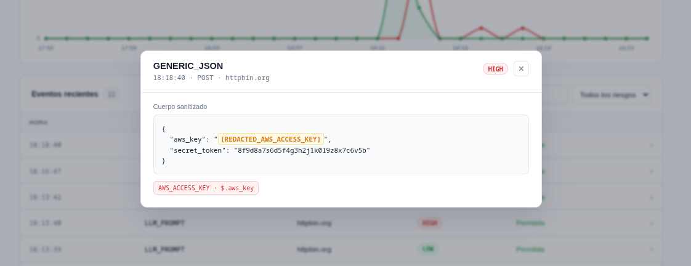

# ProxyGo

[](LICENSE)
[](https://go.dev/)
[](https://www.rust-lang.org/)

**Inspector y Firewall de Tráfico HTTP/HTTPS/JSON (DLP - Data Loss Prevention) con observabilidad en tiempo real.**

ProxyGo actúa como un intermediario local o en VPS que intercepta peticiones y respuestas salientes hacia APIs externas (como Anthropic, OpenAI, Stripe o webhooks internos), clasifica el tráfico y evita la fuga accidental de credenciales, tokens o datos sensibles tanto en cuerpos JSON como en cabeceras HTTP mediante expresiones regulares y cálculo de entropía de Shannon, ofreciendo un panel web ligero en tiempo real.

---

## Arquitectura del Sistema

ProxyGo separa el plano de red y control del motor de inspección profunda para garantizar baja latencia y tolerancia a fallos:

```text
[App / Script / CLI]
        │  HTTP / HTTPS CONNECT (127.0.0.1:8080)
        ▼
┌───────────────────────────────┐      SSE (:8081)      ┌─────────────────────────┐
│     Plano de Red (Go)         │ ────────────────────▶ │  Dashboard Web          │
│  Proxy + MITM CA + Políticas  │                       │  HTML / CSS / Chart.js  │
└───────────────┬───────────────┘                       └─────────────────────────┘
                │ Unix Domain Socket (/run/proxygo/engine.sock)
                ▼
┌───────────────────────────────┐
│   Motor de Inspección (Rust)  │
│  Regex + Entropía + Sanitizar │
└───────────────────────────────┘
```

* **Plano de Red y Control (Go):** Gestiona el proxy HTTP y túneles HTTPS MITM con certificados dinámicos por dominio, aplica políticas de resiliencia (*Fail-Open* / *Fail-Closed*) y de tráfico no inspeccionable, recalcula cabeceras dinámicamente tras la sanitización, conserva el estado reciente en memoria del servidor (`GET /api/state`) y transmite eventos en vivo mediante *Server-Sent Events* (SSE) sirviendo el frontend embebido (`go:embed`). Por seguridad, ambos servidores escuchan estrictamente en `127.0.0.1`.
* **Motor de Inspección DLP (Rust):** Corre como un proceso independiente comunicado por **Unix Domain Sockets (UDS)** con protocolo NDJSON. Analiza cuerpos y cabeceras en microsegundos sin pausas de recolección de basura, detectando secretos conocidos y cadenas de alta entropía.
* **Aislamiento de Fallos:** Si el motor de Rust sufre una interrupción o excede el timeout configurado (15 ms), `systemd` lo reinicia automáticamente mientras el proxy en Go mantiene el control del tráfico según la política configurada sin colgar las conexiones.

---

## Características Principales

* **Detección Híbrida (Regex + Entropía de Shannon):** Identifica llaves de API (`sk-ant-...`, `sk-proj-...`, `AKIA...`), tokens Bearer/JWT, cadenas de conexión a bases de datos y secretos aleatorios sin prefijo conocido, tanto en JSON profundamente anidado como en cabeceras HTTP.
* **Inspección HTTPS MITM Opcional:** Genera una CA raíz ECDSA P-256 local y certificados por host en memoria, con protección SSRF contra redes privadas (`PROXYGO_BLOCK_PRIVATE_NETWORKS`) y políticas configurables para conexiones no inspeccionables (`ALLOW_UNINSPECTED`, `MONITOR_UNINSPECTED`, `BLOCK_UNINSPECTED`).
* **Tres Modos de Operación en Caliente:**
  * `MONITOR`: Audita, clasifica y registra el tráfico sin alterar peticiones ni respuestas.
  * `SANITIZE`: Reemplaza credenciales detectadas por etiquetas seguras (`[REDACTED_...]`) antes de que salgan a internet o regresen al cliente.
  * `BLOCK`: Detiene la petición o respuesta inmediatamente con estado `HTTP 403 Forbidden` y emite una alerta crítica.
* **Dashboard Minimalista con Estado en Servidor:** Interfaz web ligera construida con HTML, CSS puro y Chart.js embebida directamente en el binario de Go. Los contadores, métricas por minuto y eventos recientes persisten en el servidor al recargar el navegador, distinguiendo tráfico HTTP/HTTPS y eventos inspeccionados, sanitizados, bloqueados o con errores TLS.
* **Administración Integrada:** CLI (`proxygo-cli`) y unidades `systemd` endurecidas para operar ambos servicios de forma unificada.

---

## Instalación

### Opción 1: Instalación rápida en Debian / Ubuntu
Descarga e instala el paquete `.deb` oficial desde GitHub Releases:

```bash
curl -fsSL https://raw.githubusercontent.com/andremateovas-debug/proxygo/main/install.sh | bash
```

### Opción 2: Compilación desde el código fuente

**Requisitos:** Go 1.22+, Rust / Cargo 1.78+ y Linux (o WSL2) para soporte nativo de Unix Domain Sockets.

```bash
git clone https://github.com/andremateovas-debug/proxygo.git
cd proxygo

make build
```

Los binarios generados quedarán en `build/proxygo-proxy`, `build/proxygo-cli` y `engine-rust/target/release/proxygo-engine`.

---

## Uso y Comandos

### Gestión de Servicios
```bash
sudo proxygo-cli start                 # Inicia el motor Rust y el proxy Go
sudo proxygo-cli stop                  # Detiene ambos servicios
sudo proxygo-cli restart engine        # Reinicia solo el motor Rust sin cortar conexiones activas
sudo proxygo-cli status                # Muestra estado de los procesos y del socket UDS
sudo proxygo-cli ca-export /tmp/ca.crt # Exporta el certificado público de la CA raíz
sudo proxygo-cli tui                   # Abre el dashboard interactivo en la terminal
```

La TUI usa `PROXYGO_DASH_ADDR` (por defecto `127.0.0.1:8081`) para la API/SSE y
`PROXYGO_PROXY_ADDR` (por defecto `127.0.0.1:8080`) para ejecutar las pruebas
de reacción. En la TUI, `1`/`2`/`3` cambian el modo, `Tab` abre el menú, `r`
abre las cinco pruebas de [`test_de_reaccion.md`](test_de_reaccion.md), las
flechas seleccionan eventos y `Enter` muestra el detalle sanitizado.

### Enrutar tráfico a través de ProxyGo
Configura la variable de entorno `HTTP_PROXY` en tu terminal, script o aplicación:

```bash
export HTTP_PROXY="http://127.0.0.1:8080"

# Ejemplo de petición HTTP auditada
curl -x http://127.0.0.1:8080 -X POST http://httpbin.org/post \
  -H "Content-Type: application/json" \
  -d '{"model": "claude-3-7-sonnet", "prompt": "Hola mundo"}'
```

Accede al panel de monitoreo en tiempo real desde tu navegador en: **`http://127.0.0.1:8081`**

---

## HTTPS MITM (opcional)

ProxyGo puede descifrar e inspeccionar tráfico HTTPS generando su propia CA y certificados por dominio. Está apagado por defecto y **exige** definir `PROXYGO_CONNECT_ALLOWED_HOSTS` (una lista explícita de dominios o `*` en entornos de prueba):

```bash
sudo systemctl edit proxygo-proxy.service
```

```ini
[Service]
Environment="PROXYGO_MITM_ENABLED=true"
Environment="PROXYGO_CA_ORG=Mi Organizacion"
Environment="PROXYGO_CONNECT_ALLOWED_HOSTS=api.example.com,*.trusted.example"
```

```bash
sudo systemctl restart proxygo-proxy.service
sudo proxygo-cli ca-export /tmp/proxygo-ca.crt

# Prueba HTTPS pasando por el túnel MITM
curl --proxy http://127.0.0.1:8080 --cacert /tmp/proxygo-ca.crt https://example.com/
```

Instala `proxygo-ca.crt` únicamente en los dispositivos autorizados. La guía completa de instalación y retirada en Ubuntu, Windows y macOS, así como el detalle de variables avanzadas (`PROXYGO_SECURITY_POLICY`, `PROXYGO_INSPECT_REQUESTS`, `PROXYGO_INSPECT_RESPONSES`, `PROXYGO_INSPECT_HEADERS`, `PROXYGO_BLOCK_INVALID_CERTS`, `PROXYGO_BLOCK_PRIVATE_NETWORKS`, `PROXYGO_MAX_BODY_BYTES`), está en [docs/CA.md](docs/CA.md).

---

## Solución de Problemas y Despliegue en VPS

### 1. Los servicios aparecen como `inactive` tras instalar el `.deb`
El paquete habilita las unidades en `systemd` para arrancar con el sistema, pero si tras la instalación `sudo proxygo-cli status` muestra `inactive` y `engine.sock missing`, inícialos manualmente:

```bash
sudo proxygo-cli start
sudo proxygo-cli status
```

### 2. Conflicto de puertos (`:8080` o `:8081` ocupado por Docker, Adminer, etc.)
ProxyGo **no cambia de puerto automáticamente**. Si en tu servidor o VPS ya tienes un contenedor Docker (como Adminer) u otro servicio escuchando en el puerto `8080`, `proxygo-proxy.service` fallará al arrancar con `bind: address already in use`.

1. Verifica si los puertos están ocupados:
   ```bash
   sudo ss -tulnp | grep -E ':(8080|8081)\b'
   ```
2. Si `:8080` está en uso y no quieres mover tu contenedor, reasigna el puerto de ProxyGo mediante un *override* de `systemd` usando las variables `PROXYGO_PROXY_ADDR` y `PROXYGO_DASH_ADDR`:
   ```bash
   sudo mkdir -p /etc/systemd/system/proxygo-proxy.service.d
   cat << 'EOF' | sudo tee /etc/systemd/system/proxygo-proxy.service.d/override.conf
   [Service]
   Environment="PROXYGO_PROXY_ADDR=127.0.0.1:8088"
   # Opcional si el 8081 también estuviera ocupado:
   # Environment="PROXYGO_DASH_ADDR=127.0.0.1:8089"
   EOF

   sudo systemctl daemon-reload
   sudo systemctl restart proxygo-proxy.service
   sudo proxygo-cli status
   ```
   En este caso, enruta tu tráfico apuntando al nuevo puerto (`http://127.0.0.1:8088`).

### 3. Ver el Dashboard desde un VPS remoto
Por seguridad, tanto el proxy como el panel web escuchan únicamente en `127.0.0.1` para evitar que terceros en internet intercepten el tráfico SSE o cambien el modo de operación en `/api/mode`. Para abrir el panel desde tu computadora local hacia un VPS remoto, crea un túnel SSH:

```bash
ssh -L 8081:127.0.0.1:8081 usuario@ip-de-tu-vps
```

Luego abre `http://127.0.0.1:8081` en tu navegador local.

---

## Auditoría y Pruebas

El repositorio incluye pruebas unitarias y de integración en Go y Rust, más una suite automatizada para verificar detección de fugas, sanitización de JSON anidado, túneles HTTPS MITM, concurrencia y tolerancia a fallos ante caídas del motor Rust:

```bash
make test
```

*(También puedes ejecutar únicamente el script de auditoría integral con `./audit_proxygo.sh`.)*

Si instalaste el paquete `.deb`, puedes lanzar pruebas rápidas contra el proxy en ejecución con:

```bash
/usr/share/proxygo/test-anomalies.sh
```

---

## Dashboard y ejemplos en vivo


*Panel de monitoreo con métricas, tráfico por minuto y eventos recientes.*

### Ejemplos de detección

<table>
  <tr>
    <td align="center">
      <br>
      <strong>Sanitización de una clave de Anthropic</strong>
    </td>
    <td align="center">
      <br>
      <strong>Sanitización de una clave AWS</strong>
    </td>
  </tr>
  <tr>
    <td align="center">
      <br>
      <strong>Solicitud segura</strong>
    </td>
    <td align="center">
      <br>
      <strong>Evento bloqueado</strong>
    </td>
  </tr>
</table>

Si quieres probar el dashboard con peticiones rápidas y ver cómo reaccionan las alertas, sigue las instrucciones de [Pruebas rápidas en vivo](test_de_reaccion.md).

---

## Licencia y Atribución

Este proyecto está licenciado bajo la **Licencia Apache, Versión 2.0**. Consulta los archivos [LICENSE](LICENSE) y [NOTICE](NOTICE) para más detalles.

Desarrollado por **Andre Mateo Vasquez Mosqueda / AM Devs**.