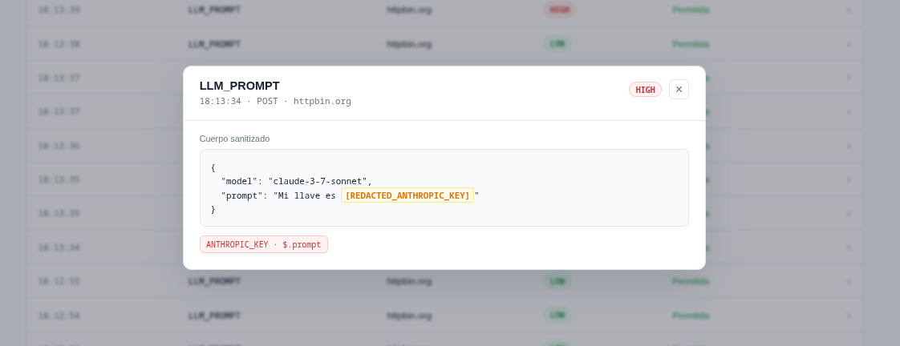
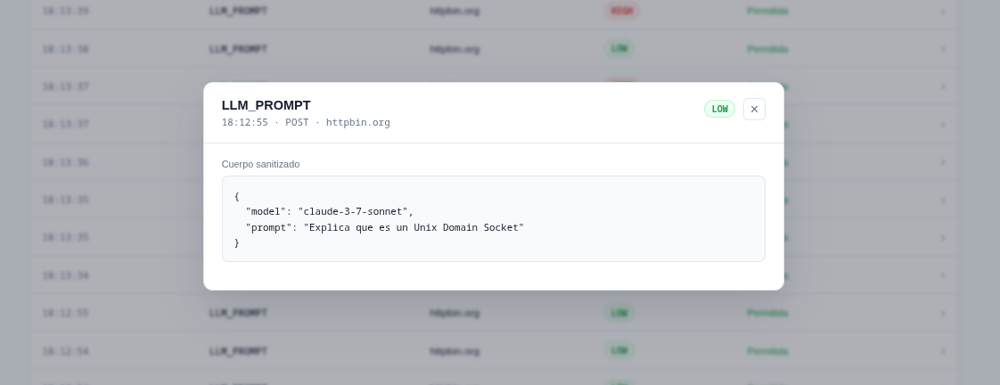

# ProxyGo

[](LICENSE)
[](https://go.dev/)
[](https://www.rust-lang.org/)

**Inspector y Firewall de Tráfico HTTP/HTTPS/JSON (DLP - Data Loss Prevention) con observabilidad en tiempo real.**

ProxyGo actúa como un intermediario local o en VPS que intercepta peticiones y respuestas salientes hacia APIs externas (como Anthropic, OpenAI, Stripe o webhooks internos), clasifica el tráfico y evita la fuga accidental de credenciales, tokens o datos sensibles tanto en cuerpos JSON como en cabeceras HTTP mediante expresiones regulares y cálculo de entropía de Shannon, ofreciendo un panel web ligero en tiempo real.

---

## Arquitectura del Sistema

ProxyGo separa el plano de red y control del motor de inspección profunda para garantizar baja latencia y tolerancia a fallos:

```text
[App / Script / CLI]
        │  HTTP / HTTPS CONNECT (127.0.0.1:8080)
        ▼
┌───────────────────────────────┐  API / SSE (:8081)  ┌─────────────────────────┐
│     Plano de Red (Go)         │ ──────────────────▶ │  Dashboard Web          │
│  Proxy + MITM CA + Políticas  │                     │  HTML / CSS / Chart.js  │
└───────────────┬───────────────┘                     └─────────────────────────┘
                │
                ├───────────────────────────────────▶ ┌─────────────────────────┐
                │          API / SSE (:8081)          │  TUI de consola         │
                │                                     │  proxygo-cli            │
                │                                     └─────────────────────────┘
                │ Unix Domain Socket (/run/proxygo/engine.sock)
                ▼
┌───────────────────────────────┐
│   Motor de Inspección (Rust)  │
│  Regex + Entropía + Sanitizar │
└───────────────────────────────┘
```

- **Plano de Red y Control (Go):** Gestiona el proxy HTTP y túneles HTTPS MITM con certificados dinámicos por dominio, aplica políticas de resiliencia (*Fail-Open* / *Fail-Closed*) y de tráfico no inspeccionable, recalcula cabeceras dinámicamente tras la sanitización, conserva el estado reciente en memoria del servidor (`GET /api/state`) y transmite eventos en vivo mediante *Server-Sent Events* (SSE) sirviendo el frontend embebido (`go:embed`). Por defecto, ambos servidores escuchan únicamente en `127.0.0.1` (cualquier bind no-loopback del panel exige autenticación explícita).
- **Motor de Inspección DLP (Rust):** Corre como un proceso independiente comunicado por **Unix Domain Sockets (UDS)** con protocolo NDJSON. Analiza cuerpos y cabeceras en microsegundos sin pausas de recolección de basura, detectando secretos conocidos y cadenas de alta entropía.
- **Aislamiento de Fallos:** Si el motor de Rust sufre una interrupción o excede el timeout configurado (15 ms), `systemd` lo reinicia automáticamente mientras el proxy en Go mantiene el control del tráfico según la política configurada sin colgar las conexiones.

---

## Características Principales

- **Detección Híbrida (Regex + Entropía de Shannon):** Identifica llaves de API (`sk-ant-...`, `sk-proj-...`, `AKIA...`), tokens Bearer/JWT, cadenas de conexión a bases de datos y secretos aleatorios sin prefijo conocido, tanto en JSON profundamente anidado como en cabeceras HTTP.
- **Inspección HTTPS MITM Opcional:** Genera una CA raíz ECDSA P-256 local y certificados por host en memoria, con protección SSRF contra redes privadas (`PROXYGO_BLOCK_PRIVATE_NETWORKS`) y políticas configurables para conexiones no inspeccionables (`ALLOW_UNINSPECTED`, `MONITOR_UNINSPECTED`, `BLOCK_UNINSPECTED`).
- **Tres Modos de Operación en Caliente:**
  - `MONITOR`: Audita, clasifica y registra el tráfico sin alterar peticiones ni respuestas.
  - `SANITIZE`: Reemplaza credenciales detectadas por etiquetas seguras (`[REDACTED_...]`) antes de que salgan a internet o regresen al cliente.
  - `BLOCK`: Detiene la petición o respuesta inmediatamente con estado `HTTP 403 Forbidden` y emite una alerta crítica.
- **Dashboard Minimalista con Estado en Servidor:** Interfaz web ligera construida con HTML, CSS puro y Chart.js embebida directamente en el binario de Go. Los contadores, métricas por minuto y eventos recientes persisten en el servidor al recargar el navegador, distinguiendo tráfico HTTP/HTTPS y eventos inspeccionados, sanitizados, bloqueados o con errores TLS.
- **Administración Integrada:** CLI (`proxygo-cli`) y unidades `systemd` endurecidas para operar ambos servicios de forma unificada.

---

## Instalación

### Opción 1: Instalación rápida en Debian / Ubuntu
Descarga e instala el paquete `.deb` oficial desde GitHub Releases:

```bash
curl -fsSL [https://raw.githubusercontent.com/andremateovas-debug/proxygo/main/install.sh](https://raw.githubusercontent.com/andremateovas-debug/proxygo/main/install.sh) | bash
```

### Opción 2: Compilación desde el código fuente

**Requisitos:** Go 1.22+, Rust / Cargo 1.78+ y Linux (o WSL2) para soporte nativo de Unix Domain Sockets.

```bash
git clone [https://github.com/andremateovas-debug/proxygo.git](https://github.com/andremateovas-debug/proxygo.git)
cd proxygo

make build
```

Los binarios generados quedarán en `build/proxygo-proxy`, `build/proxygo-cli` y `engine-rust/target/release/proxygo-engine`.

---

## Uso y Comandos

### Gestión de Servicios
```bash
sudo proxygo-cli start                 # Inicia el motor Rust y el proxy Go
sudo proxygo-cli stop                  # Detiene ambos servicios
sudo proxygo-cli restart engine        # Reinicia solo el motor Rust sin cortar conexiones activas
sudo proxygo-cli status                # Muestra estado de los procesos y del socket UDS
sudo proxygo-cli ca-export /tmp/ca.crt # Exporta el certificado público de la CA raíz
sudo proxygo-cli tui                   # Abre el dashboard interactivo en la terminal
```

La TUI usa `PROXYGO_DASH_ADDR` (por defecto `127.0.0.1:8081`) para la API/SSE, `PROXYGO_PROXY_ADDR` (o `PROXY_ADDR`, por defecto `127.0.0.1:8080`) para ejecutar las pruebas de reacción y `PROXYGO_CA_DIR` para la prueba HTTPS MITM. En la TUI, `1`/`2`/`3` cambian el modo, `Tab` abre el menú (incluyendo el estado/toggle de CA), `r` abre las pruebas de [`test_de_reaccion.md`](test_de_reaccion.md), las flechas seleccionan eventos y `Enter` muestra el detalle sanitizado.

> **Nota sobre `sudo` y variables de entorno:** Por defecto, `sudo` suele reiniciar las variables de entorno (`env_reset`). Si reasignaste el puerto del proxy (por ejemplo a `127.0.0.1:8088`) o necesitas leer `/var/lib/proxygo/ca/ca.crt` con `sudo`, pasa las variables con `sudo env` o crea un script *wrapper* en `/usr/local/bin/proxygo-tui`:
> ```bash
> sudo env PROXYGO_PROXY_ADDR="127.0.0.1:8088" PROXY_ADDR="127.0.0.1:8088" \
>   PROXYGO_DASH_ADDR="127.0.0.1:8081" PROXYGO_CA_DIR="/var/lib/proxygo/ca" proxygo-cli tui
> ```

### Enrutar tráfico a través de ProxyGo
Configura las variables de entorno `HTTP_PROXY` y `HTTPS_PROXY` en tu terminal, script o aplicación:

```bash
export HTTP_PROXY="[http://127.0.0.1:8080](http://127.0.0.1:8080)"
export HTTPS_PROXY="[http://127.0.0.1:8080](http://127.0.0.1:8080)"

# Ejemplo de petición HTTP auditada
curl -x [http://127.0.0.1:8080](http://127.0.0.1:8080) -X POST [http://httpbin.org/post](http://httpbin.org/post) \
  -H "Content-Type: application/json" \
  -d '{"model": "claude-3-7-sonnet", "prompt": "Hola mundo"}'
```

Accede al panel de monitoreo en tiempo real desde tu navegador en: **`http://127.0.0.1:8081`**

### Seguridad de la administración

El panel escucha por defecto solo en `127.0.0.1:8081`. En el primer inicio, ProxyGo genera un token aleatorio de 256 bits y lo guarda en `/var/lib/proxygo/admin.token` con permisos `0600`; conserva únicamente su hash SHA-256 en memoria y nunca lo devuelve por HTTP ni lo escribe en logs. En un bind loopback, las lecturas del dashboard siguen abiertas; los controles de modo y CA solicitan el token. En un bind no-loopback, la primera lectura del estado solicita el token y el navegador recibe una cookie de sesión `HttpOnly` para mantener abierto el flujo SSE. La TUI lee el mismo token del archivo si el usuario tiene permiso.

Para recuperar el token generado en una instalación con `systemd`:

```bash
sudo cat /var/lib/proxygo/admin.token
```

También puedes proporcionar un token propio de al menos 32 caracteres mediante `PROXYGO_ADMIN_TOKEN`, o elegir un archivo privado con `PROXYGO_ADMIN_TOKEN_FILE`. El valor del entorno prevalece sobre el archivo. Para un token de entorno, usa un archivo de entorno de `systemd` protegido en lugar de incluir el secreto directamente en la unidad:

```bash
sudo install -d -m 0700 /etc/proxygo
sudo sh -c 'umask 077; printf "PROXYGO_ADMIN_TOKEN=%s\n" "$(openssl rand -base64 48)" > /etc/proxygo/admin.env'
sudo systemctl edit proxygo-proxy.service
```

Añade al *override*:

```ini
[Service]
EnvironmentFile=/etc/proxygo/admin.env
```

Para usar un archivo de token explícito, crea uno privado y configura `PROXYGO_ADMIN_TOKEN_FILE` en el mismo *override*. Esta declaración explícita es obligatoria si `PROXYGO_DASH_ADDR` escucha fuera de loopback:

```bash
sudo install -d -o proxygo -g proxygo -m 0700 /var/lib/proxygo
sudo -u proxygo sh -c 'umask 077; openssl rand -base64 48 > /var/lib/proxygo/admin.token'
```

```ini
[Service]
Environment="PROXYGO_ADMIN_TOKEN_FILE=/var/lib/proxygo/admin.token"
```

Aplica los cambios con `sudo systemctl daemon-reload` y reinicia el servicio. El token se transmite por HTTP al navegador, por lo que un bind remoto requiere un canal de red confiable/cifrado; el mecanismo recomendado sigue siendo el loopback predeterminado con túnel SSH.

Las operaciones `POST /api/mode` y `POST /api/ca` siempre exigen `Authorization: Bearer <token>` y un encabezado `Origin` del mismo origen. Con un bind no-loopback, también lo exigen `GET /api/state`, `GET /api/mode`, `GET /api/ca` y `GET /events`; en loopback esas lecturas no requieren token. Los orígenes cruzados y encabezados de autorización duplicados se rechazan. La TUI adjunta el token a sus lecturas y cambios de estado. Las vistas de cabeceras ocultan valores de autorización, cookies, claves API, tokens y secretos.

Si el servicio usa `PROXYGO_ADMIN_TOKEN` desde `/etc/proxygo/admin.env`, inicia la TUI cargando ese mismo archivo, por ejemplo:

```bash
sudo bash -c 'set -a; . /etc/proxygo/admin.env; exec proxygo-cli tui'
```

Si configuraste `PROXYGO_ADMIN_TOKEN_FILE`, pasa también esa variable al proceso `proxygo-cli tui`.

Si configuras `PROXYGO_DASH_ADDR` en una interfaz no loopback, debes declarar explícitamente `PROXYGO_ADMIN_TOKEN` o `PROXYGO_ADMIN_TOKEN_FILE`; de lo contrario, ProxyGo no inicia. El panel usa HTTP sin cifrado: mantén el bind en loopback y usa un túnel SSH para administración remota. No expongas directamente el puerto del dashboard a redes no confiables.

---

## HTTPS MITM (opcional)

ProxyGo puede descifrar e inspeccionar tráfico HTTPS generando su propia CA ECDSA P-256 y certificados dinámicos por dominio. Está apagado por defecto y **exige** definir `PROXYGO_CONNECT_ALLOWED_HOSTS` (una lista explícita de dominios o `*` en entornos de prueba).

### Opción A: Activar o desactivar en caliente desde la TUI (o Dashboard)

1. Asegúrate de que el servicio tenga definidos los hosts permitidos en `systemd` (si no, la activación devolverá un error indicando que `PROXYGO_CONNECT_ALLOWED_HOSTS` está vacío):
   ```bash
   sudo systemctl edit proxygo-proxy.service
   ```
   ```ini
   [Service]
   Environment="PROXYGO_CONNECT_ALLOWED_HOSTS=*"
   ```
   ```bash
   sudo systemctl daemon-reload
   sudo systemctl restart proxygo-proxy.service
   ```
2. Abre la TUI con permisos para leer la CA y el token administrativo:
   ```bash
   sudo env PROXYGO_PROXY_ADDR="127.0.0.1:8080" PROXY_ADDR="127.0.0.1:8080" \
     PROXYGO_DASH_ADDR="127.0.0.1:8081" PROXYGO_CA_DIR="/var/lib/proxygo/ca" proxygo-cli tui
   ```
   *(Ajusta `127.0.0.1:8080` si reasignaste el puerto del proxy.)*
3. Presiona **`Tab`** para abrir el menú operativo, selecciona **`CA / MITM`** y pulsa **`Enter`** para alternar entre `OFF` y `ON` en caliente.

> Este cambio desde la TUI (o desde el panel web) se aplica en memoria al proceso en ejecución; si reinicias `proxygo-proxy.service`, volverá al estado definido en `systemd`.

### Opción B: Mantenerlo activo de forma persistente en `systemd`

```bash
sudo systemctl edit proxygo-proxy.service
```

```ini
[Service]
Environment="PROXYGO_MITM_ENABLED=true"
Environment="PROXYGO_CA_ORG=Mi Organizacion"
Environment="PROXYGO_CONNECT_ALLOWED_HOSTS=api.example.com,*.trusted.example"
```

```bash
sudo systemctl restart proxygo-proxy.service
```

### Exportar y probar la CA

```bash
sudo proxygo-cli ca-export /tmp/proxygo-ca.crt

# Prueba HTTPS pasando por el túnel MITM
curl --proxy [http://127.0.0.1:8080](http://127.0.0.1:8080) --cacert /tmp/proxygo-ca.crt [https://example.com/](https://example.com/)
```

Instala `proxygo-ca.crt` únicamente en los dispositivos autorizados. Por defecto, `PROXYGO_BLOCK_PRIVATE_NETWORKS=true` bloquea destinos privados/loopback en `CONNECT` para evitar SSRF, y el tráfico que no puede descifrarse como HTTP/1.1 (como HTTP/2, HTTP/3/QUIC, WebSockets, mTLS o *certificate pinning*) se rige por `PROXYGO_SECURITY_POLICY`.

La guía completa de instalación y retirada en Ubuntu, Windows y macOS, así como el detalle de variables avanzadas (`PROXYGO_SECURITY_POLICY`, `PROXYGO_INSPECT_REQUESTS`, `PROXYGO_INSPECT_RESPONSES`, `PROXYGO_INSPECT_HEADERS`, `PROXYGO_BLOCK_INVALID_CERTS`, `PROXYGO_BLOCK_PRIVATE_NETWORKS`, `PROXYGO_MAX_BODY_BYTES`), está en [docs/CA.md](docs/CA.md).

---

## Solución de Problemas y Despliegue en VPS

### 1. Los servicios aparecen como `inactive` tras instalar el `.deb`
El paquete habilita las unidades en `systemd` para arrancar con el sistema, pero si tras la instalación `sudo proxygo-cli status` muestra `inactive` y `engine.sock missing`, inícialos manualmente:

```bash
sudo proxygo-cli start
sudo proxygo-cli status
```

### 2. Conflicto de puertos (`:8080` o `:8081` ocupado por Docker, Adminer, etc.)
ProxyGo **no cambia de puerto automáticamente**. Si en tu servidor o VPS ya tienes un contenedor Docker (como Adminer) u otro servicio escuchando en el puerto `8080`, `proxygo-proxy.service` fallará al arrancar con `bind: address already in use`.

1. Verifica si los puertos están ocupados:
   ```bash
   sudo ss -tulnp | grep -E ':(8080|8081)\b'
   ```
2. Si `:8080` está en uso y no quieres mover tu contenedor, reasigna el puerto de ProxyGo mediante un *override* de `systemd` usando las variables `PROXYGO_PROXY_ADDR` y `PROXYGO_DASH_ADDR`:
   ```bash
   sudo mkdir -p /etc/systemd/system/proxygo-proxy.service.d
   cat << 'EOF' | sudo tee /etc/systemd/system/proxygo-proxy.service.d/override.conf
   [Service]
   Environment="PROXYGO_PROXY_ADDR=127.0.0.1:8088"
   # Opcional si el 8081 también estuviera ocupado:
   # Environment="PROXYGO_DASH_ADDR=127.0.0.1:8089"
   EOF

   sudo systemctl daemon-reload
   sudo systemctl restart proxygo-proxy.service
   sudo proxygo-cli status
   ```
   En este caso, enruta tu tráfico apuntando al nuevo puerto (`http://127.0.0.1:8088`).

### 3. Ver el Dashboard desde un VPS remoto
Por seguridad, tanto el proxy como el panel web escuchan únicamente en `127.0.0.1` para evitar que terceros en internet intercepten el tráfico SSE o cambien el modo de operación en `/api/mode`. Para abrir el panel desde tu computadora local hacia un VPS remoto, crea un túnel SSH:

```bash
ssh -L 8081:127.0.0.1:8081 usuario@ip-de-tu-vps
```

Luego abre `http://127.0.0.1:8081` en tu navegador local.

---

## Auditoría y Pruebas

El repositorio incluye pruebas unitarias y de integración en Go y Rust, más una suite automatizada para verificar detección de fugas, sanitización de JSON anidado, túneles HTTPS MITM, concurrencia y tolerancia a fallos ante caídas del motor Rust:

```bash
make test
```

*(También puedes ejecutar únicamente el script de auditoría integral con `./audit_proxygo.sh`.)*

Si instalaste el paquete `.deb`, puedes lanzar las pruebas rápidas de anomalías y `FAIL_CLOSED` (requiere `sudo` para leer el token administrativo y probar la caída de `proxygo-engine.service`):

```bash
sudo /usr/share/proxygo/test-anomalies.sh

# Si reasignaste el puerto del proxy (por ejemplo a 8088):
sudo env PROXYGO_TEST_PROXY_URL="[http://127.0.0.1:8088](http://127.0.0.1:8088)" /usr/share/proxygo/test-anomalies.sh
```

---

## Dashboard y ejemplos en vivo


*Panel de monitoreo con métricas, tráfico por minuto y eventos recientes.*

### Ejemplos de detección

<table>
  <tr>
    <td align="center">
      <br>
      <strong>Sanitización de una clave de Anthropic</strong>
    </td>
    <td align="center">
      <br>
      <strong>Sanitización de una clave AWS</strong>
    </td>
  </tr>
  <tr>
    <td align="center">
      <br>
      <strong>Solicitud segura</strong>
    </td>
    <td align="center">
      <br>
      <strong>Evento bloqueado</strong>
    </td>
  </tr>
</table>

Si quieres probar el dashboard con peticiones rápidas y ver cómo reaccionan las alertas, sigue las instrucciones de [Pruebas rápidas en vivo](test_de_reaccion.md).

---

## Licencia y Atribución

Este proyecto está licenciado bajo la **Licencia Apache, Versión 2.0**. Consulta los archivos [LICENSE](LICENSE) y [NOTICE](NOTICE) para más detalles.

Desarrollado por **Andre Mateo Vasquez Mosqueda / AM Devs**.
